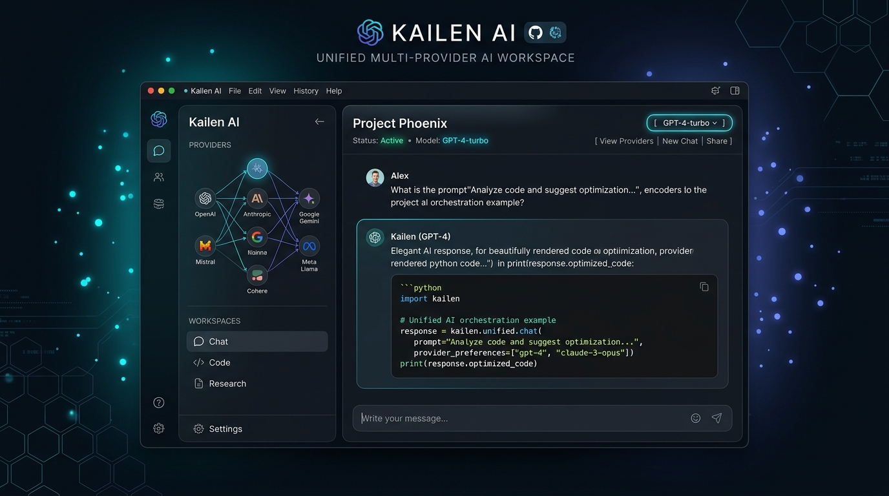
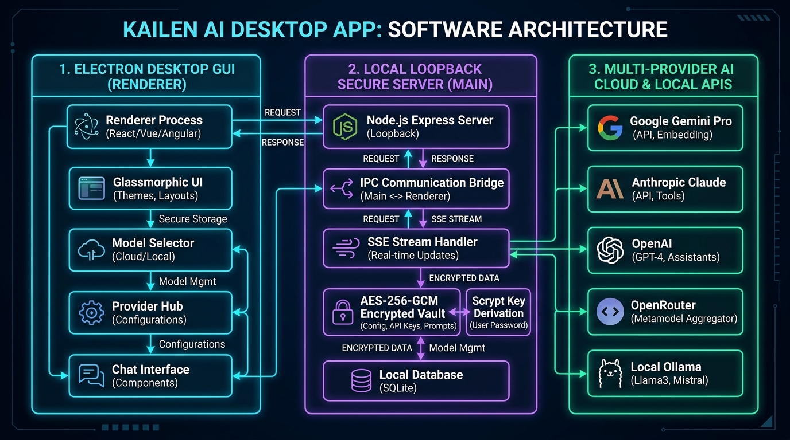
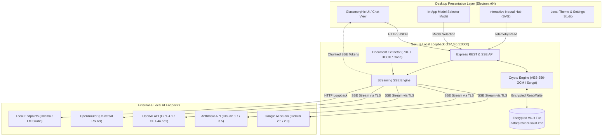
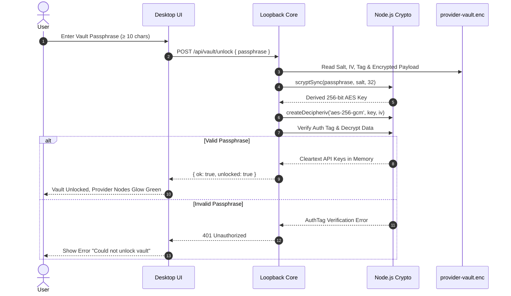
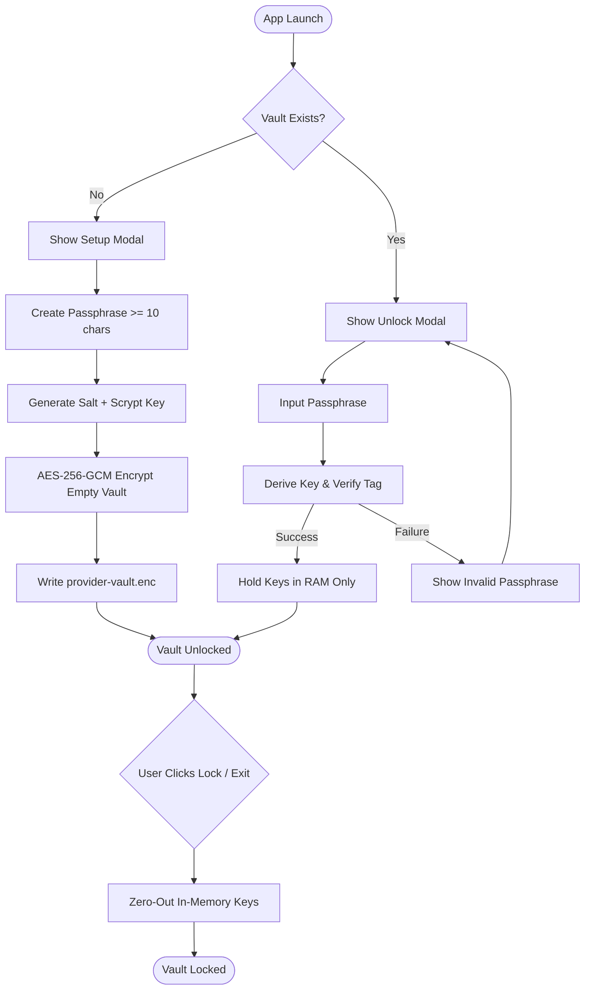
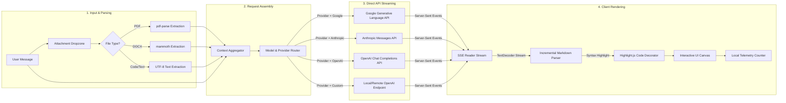
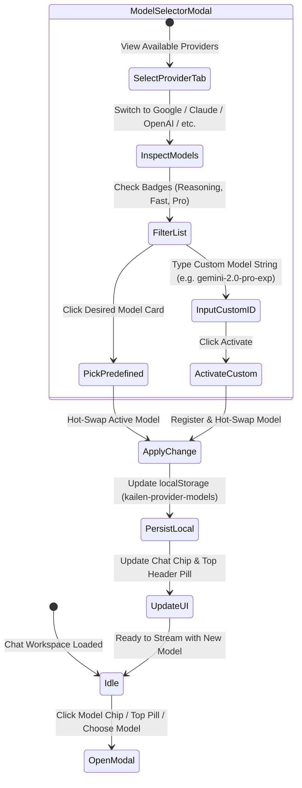

<div align="center">

  

  # Kailen AI Desktop

  **Unified Multi-Provider AI Workspace & Local-First Neural Hub for Windows**

  [-0078D6?style=for-the-badge&logo=windows&logoColor=white)](https://github.com)
  [](https://electronjs.org/)
  [](https://nodejs.org/)
  [](https://nodejs.org/api/crypto.html)
  [](https://github.com)
  [](https://github.com/chaitanya844/Kailen-AI/releases)

  <p align="center">
    <em>One high-performance desktop workspace for every frontier AI model. Bring your own keys, keep them encrypted locally, and switch models with a single click.</em>
  </p>

</div>

---

<div align="center">
  
</div>

---

## 📑 Table of Contents

- [Overview](#-overview)
- [Key Features](#-key-features)
- [Architecture & Data Flow](#-architecture--data-flow)
- [Security & Vault Architecture](#-security--vault-architecture)
- [Workflows & Processes](#-workflows--processes)
  - [1. Vault Encryption & Session Unlock](#1-vault-encryption--session-unlock-lifecycle)
  - [2. Multi-Provider Streaming & Pipeline](#2-multi-provider-chat--streaming-pipeline)
  - [3. Dynamic Model Switching System](#3-dynamic-model-switching-system)
- [Supported Providers & Model Catalogue](#-supported-providers--model-catalogue)
- [Interactive Neural Provider Hub](#-interactive-neural-provider-hub)
- [Getting Started](#-getting-started)
  - [Prerequisites](#prerequisites)
  - [Running from Source](#running-from-source)
  - [Building Windows Installer (.exe)](#building-windows-installer-exe)
  - [Standalone Web Mode](#standalone-web-mode)
- [Repository Structure](#-repository-structure)
- [Configuration & Settings Studio](#-configuration--settings-studio)
- [Privacy & Security Best Practices](#-privacy--security-best-practices)
- [License](#-license)

---

## 🌟 Overview

**Kailen AI** is an enterprise-grade, local-first Windows desktop client designed for developers, researchers, and power users who interact with multiple artificial intelligence providers. Instead of juggling dozens of browser tabs, monthly vendor lock-ins, and insecure plaintext API keys, Kailen AI provides:

1. **A Single Unified Canvas**: Chat, code, analyze documents, and experiment with Google Gemini, Anthropic Claude, OpenAI, OpenRouter, and local models in one unified conversation stream.
2. **Bring Your Own Keys (BYOK)**: Pay providers directly at cost with zero platform markup or middleman cloud servers.
3. **Military-Grade Local Vault**: Secrets never leave your PC. All keys are encrypted at rest using **AES-256-GCM** with a **Scrypt**-derived key.
4. **Instant In-App Model Switching**: Switch dynamically between `gemini-2.5-pro`, `claude-3-7-sonnet`, `gpt-4o`, `deepseek-r1`, or custom fine-tuned weights without reloading conversations.
5. **Rich Document Ingestion**: Ingest and query `.pdf`, `.docx`, `.txt`, `.csv`, `.json`, and source code files locally up to 5 MB per document.

---

## 🚀 Key Features

| Capability | Specification | Benefit |
| :--- | :--- | :--- |
| **Multi-Provider Hub** | Google Gemini, Anthropic Claude, OpenAI, OpenRouter, Custom | Complete vendor independence; switch models instantly |
| **Vault Encryption** | AES-256-GCM + Scrypt KDF (`N=16384, r=8, p=1`) | Zero-knowledge security; secrets never touch the cloud |
| **Model Switcher** | In-app modal with badges & custom model ID entry | Zero prompt popups; instant hot-switching per message |
| **Local LLM Support** | Ollama, LM Studio, vLLM, LocalAI via OpenAI compatibility | Full offline private inference on local GPUs |
| **Neural Hub** | Dynamic SVG constellation with token telemetry | Visual usage monitoring and cost estimations |
| **Document Processing**| Native `pdf-parse` & `mammoth` document extractors | Local document intelligence without cloud upload pre-parsing |
| **Design System** | Glassmorphic CSS, 6 curated themes, customizable glow | High-aesthetic, responsive dark & light modes |

---

## 🏗 Architecture & Data Flow

Kailen AI operates on an **isolated dual-layer local architecture**:

1. **Desktop Presentation Layer (Electron Renderer)**: Sandboxed HTML5/Vanilla CSS/JavaScript interface with context isolation enabled and Node.js integration disabled for maximum defense-in-depth.
2. **Local Loopback Core (Express Server)**: An internal Node.js server binding strictly to `127.0.0.1` (loopback). It manages cryptographic operations, vault storage, streaming SSE connections, and external API calls.

<div align="center">
  
</div>

### System Topology (Mermaid)



---

## 🔒 Security & Vault Architecture

Kailen AI eliminates cloud credential risks by using a **Zero-Knowledge Local Encrypted Vault**:

- **Key Derivation Function (KDF)**: Node.js `crypto.scryptSync` with high memory/CPU cost parameters (`N=16384, r=8, p=1`) and a 16-byte cryptographically secure random salt.
- **Authenticated Encryption**: `AES-256-GCM` with a 12-byte initialization vector (`IV`) and a 16-byte authentication tag ensuring ciphertext integrity and confidentiality.
- **Memory-Only Cleartext**: Decrypted API keys reside strictly in transient memory during an unlocked session and are purged immediately when the vault is locked or the application exits.
- **Strict Loopback Binding**: The Express backend binds exclusively to `127.0.0.1`. No external network interface is exposed.



---

## 🔄 Workflows & Processes

### 1. Vault Encryption & Session Unlock Lifecycle



---

### 2. Multi-Provider Chat & Streaming Pipeline



---

### 3. Dynamic Model Switching System



---

## 🤖 Supported Providers & Model Catalogue

Kailen AI includes a rich default catalogue across all major frontier providers, with full support for user-defined model IDs:

### Google Gemini (`google`)
* **Endpoint**: `https://generativelanguage.googleapis.com/v1beta/`
* **Streaming Protocol**: Native Server-Sent Events (`streamGenerateContent?alt=sse`)
* **Preconfigured Models**:
  - `gemini-2.5-flash` *(Recommended · Next-gen speed & intelligence)*
  - `gemini-2.5-pro` *(Flagship · Advanced reasoning & coding)*
  - `gemini-2.0-flash` *(Realtime · Ultra-low latency streaming)*
  - `gemini-2.0-flash-lite` *(Lightweight · Everyday cost efficiency)*
  - `gemini-1.5-pro` *(Deep Context · 2M token context window)*
  - `gemini-1.5-flash` *(Versatile · Balanced multimodal processing)*
* **Custom Models**: Supported (e.g., `gemini-2.0-pro-exp-02-05`, fine-tuned models)

### Anthropic Claude (`anthropic`)
* **Endpoint**: `https://api.anthropic.com/v1/messages`
* **Streaming Protocol**: Native Anthropic Event Stream (`content_block_delta`)
* **Preconfigured Models**:
  - `claude-3-7-sonnet-latest` *(Hybrid Reasoning · State-of-the-art coding)*
  - `claude-3-5-sonnet-latest` *(Industry Benchmark · Deep analysis & nuances)*
  - `claude-3-5-haiku-latest` *(Blazing Fast · High velocity tasks)*
  - `claude-3-opus-latest` *(Maximum Depth · Complex writing & philosophical depth)*
  - `claude-3-opus-20240229` *(Opus Classic · Original high-parameter foundation)*

### OpenAI (`openai`)
* **Endpoint**: `https://api.openai.com/v1/chat/completions`
* **Streaming Protocol**: Server-Sent Events (`choices[0].delta.content`)
* **Preconfigured Models**:
  - `gpt-4.1-mini` *(Recommended · Next-gen smart everyday workhorse)*
  - `gpt-4.1` *(Flagship · Deep general intelligence & reasoning)*
  - `gpt-4o` *(Multimodal · High-speed flagship multimodal model)*
  - `gpt-4o-mini` *(Fast · Lightweight multimodal)*
  - `o3-mini` *(STEM & Code · Advanced reasoning model)*
  - `o1` *(Deep Thinking · Full complex scientific reasoning)*
  - `o1-mini` *(Fast Reasoning · Efficient math & coding)*
  - `gpt-4-turbo` *(Legacy Flagship · Proven high accuracy)*

### OpenRouter (`openrouter`)
* **Endpoint**: `https://openrouter.ai/api/v1/chat/completions`
* **Streaming Protocol**: Unified OpenAI-Compatible SSE
* **Preconfigured Models**:
  - `deepseek/deepseek-r1` *(Open reasoning model)*
  - `meta-llama/llama-3.3-70b-instruct` *(Meta open weights)*
  - `mistralai/mistral-large-2411` *(European frontier flagship)*
  - `openai/gpt-4.1-mini`
  - `anthropic/claude-3.7-sonnet`
  - `google/gemini-2.5-flash`

### Custom OpenAI-Compatible Endpoints (`custom`)
* **Compatibility**: Ollama, LM Studio, vLLM, LocalAI, DeepSeek API, Groq, Together AI, Mistral API.
* **Authentication**: Optional for local endpoints (`localhost:11434`), Bearer token for cloud endpoints.
* **Model Configuration**: Enter primary model identifier and comma-separated alternative models.

---

## 🌌 Interactive Neural Provider Hub

The **Provider Hub** features an interactive vector-based SVG constellation graph:

<div align="center">
  
</div>

- **Dynamic Node Sizing**: Each provider node's radius scales logarithmically with your local estimated token consumption.
- **Connection Glow**: Connected providers with validated keys radiate with their signature accent hue.
- **Provider Inspector**: Clicking any constellation node displays:
  - Total local requests executed.
  - Approximate input/output token volume.
  - Model activity distribution.
  - User-configurable pricing estimation calculator ($ per 1M tokens).
  - Quick key management & model switching.

> [!NOTE]
> All token metrics and financial approximations are calculated entirely on your local machine using text character heuristics. Kailen AI never contacts provider billing portals or transmits accounting records externally.

---

## 📦 Getting Started

### Prerequisites

- **Operating System**: Windows 10 or Windows 11 (64-bit).
- **Node.js**: Version `20.x LTS` or higher ([Download Node.js](https://nodejs.org/)).
- **Git**: Installed for cloning the repository.

---

### Running from Source

```powershell
# 1. Clone the repository
git clone https://github.com/chaitanya844/Kailen-AI.git
cd Kailen-AI

# 2. Install dependencies
npm install

# 3. Launch Kailen AI Desktop
npm start
```

Upon first launch:
1. You will be prompted to create your **Local Encrypted Vault Passphrase** (minimum 10 characters).
2. Navigate to the **Provider Hub** tab.
3. Click **Connect API key** on any provider (Google Gemini, Anthropic Claude, OpenAI, etc.).
4. Select your desired model from the **Model Selector** and start chatting!

---

### Building Windows Installer (.exe)

You can compile a standalone, redistributable Windows NSIS installer with desktop shortcuts and Start menu integration:

```powershell
# Ensure dependencies are installed
npm install

# Compile Windows x64 NSIS installer
npm run dist:win
```

The resulting setup executable is generated at:
```
dist/Kailen AI Setup 2.8.0.exe
```

---

### Standalone Web Mode

For headless development or testing inside standard web browsers:

```powershell
npm run start:web
```
Open `http://127.0.0.1:3000` in your browser.

---

## 📂 Repository Structure

```
kailen-ai/
├── assets/                          # Labeled screenshots, diagrams, and vector logo
│   ├── kailen-banner.jpg            # GitHub showcase banner
│   ├── kailen-architecture.jpg      # Labeled architecture infographic
│   └── logo.svg                     # Official Kailen AI vector mark
├── data/                            # Local database directory (git-ignored)
│   ├── .gitkeep
│   └── provider-vault.enc           # AES-256-GCM encrypted provider credentials
├── dist/                            # Packaged Windows executables and installers
│   └── Kailen AI Setup 2.8.0.exe    # Compiled NSIS setup installer
├── public/                          # Frontend presentation layer
│   ├── app.js                       # Client controller, model switcher, and UI logic
│   ├── index.html                   # Semantic HTML5 layout & modal templates
│   ├── style.css                    # Design system, glassmorphic styles & animations
│   ├── icon.ico                     # Windows application icon
│   └── logo.svg                     # Vector brand asset
├── main.js                          # Electron desktop entry point (window lifecycle)
├── server.js                        # Express loopback backend, crypto vault & SSE proxy
├── package.json                     # Project manifest and build scripts
└── README.md                        # Documentation
```

---

## 🎨 Configuration & Settings Studio

Kailen AI includes an in-app **Visual Customization Studio** accessible from the sidebar:

- **Theme Presets**: Midnight, Graphite, Aurora, Forest, Amethyst, and Sand.
- **Glassmorphism Controls**:
  - *Surface Opacity*: 45% to 100% (translucent glass to solid panels).
  - *Glass Blur*: 0 px to 24 px Gaussian backdrop filtering.
  - *Corner Roundness*: 8 px to 26 px curvature.
  - *Text Scale*: 90% to 115% dynamic UI font scaling.
- **Ambient Glow**: Soft localized radial gradients reflecting your active theme.
- **Reduced Motion Support**: Full compliance with Windows `prefers-reduced-motion` settings.

---

## 🛡 Privacy & Security Best Practices

1. **Vault Passphrase Safety**: Your vault passphrase is used directly to derive the AES decryption key. It is never stored in plain text anywhere on disk. If lost, encrypted keys cannot be recovered.
2. **Loopback Only**: Never alter `HOST = '127.0.0.1'` to `0.0.0.0` or expose the local server to public networks.
3. **Untrusted Custom Endpoints**: Only connect custom base URLs (`/v1`) that you control or trust (e.g. `localhost:11434` for Ollama or verified enterprise gateways).
4. **Lock Vault**: Click **Lock encrypted vault** in the sidebar or Settings when stepping away from your workstation.

---

## 📄 License

Distributed under the **MIT License**. See `LICENSE` for more information.

---

<div align="center">
  <sub>Built with precision for the modern AI workflow. Kailen AI Desktop.</sub>
</div>
